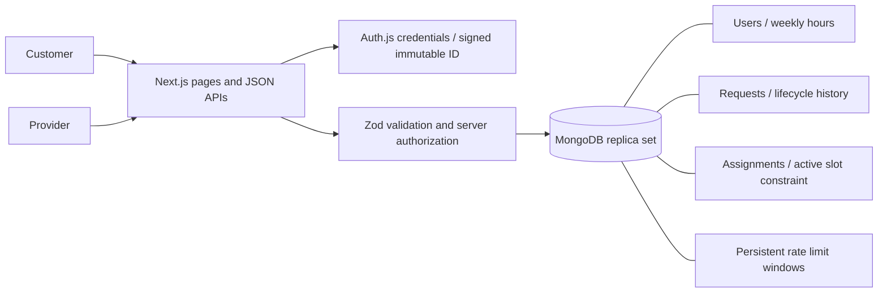

# Architecture

FIXIT retains the original team project's Next.js App Router, React, Tailwind,
Auth.js and MongoDB/Mongoose stack. No framework migration, Redis or microservice
layer was introduced.

Public pages render on the server where possible. Catalog filtering, forms,
settings and booking controls use client components. Root layout no longer
unconditionally connects to MongoDB; the navbar degrades to public navigation if
account resolution is unavailable. Server account guards protect private pages.

The server derives roles from the persisted account's service, consistent with the
team model. Provider registration is self-service; no certification or background
check is claimed. Private mutations reload the signed database ID. Request-body
identity/role fields cannot grant privileges. OAuth remains disabled until proper
account linking/onboarding exists; Auth.js v5 remains a beta dependency.

The existing two booking collections are retained. Transactions keep the request,
assignment and history consistent. Weekly availability is embedded in the user
profile; a separate availability collection is unnecessary at this scale. Pure
TypeScript policy functions define hourly slots and allowed transitions; Zod
validates network input. Existing JS is linted/tested but not all strictly typed.

Catalog pages share one source. Indexed, cursor-paginated booking APIs return
20 records per page. Provider queues reveal service/time/city only; contact details
are shared after assignment. An atomic provider document write makes acceptance
serialize against concurrent schedule changes. Existing accepted visits are honored
when a provider changes their schedule.

No admin dashboard, payments or review moderation was invented: those have no
implemented domain requirements. See API.md, DATABASE_DESIGN.md and the phase report.
