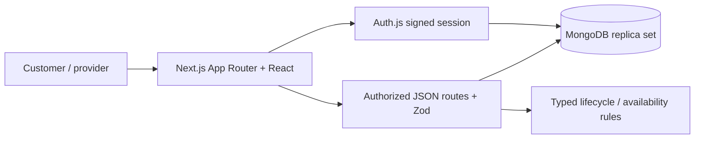
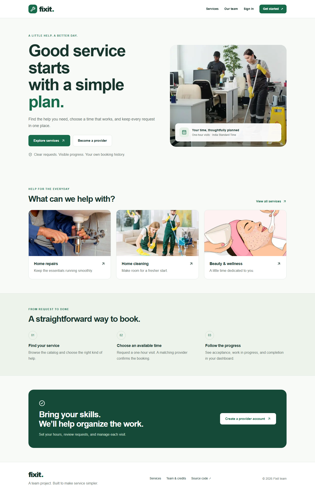
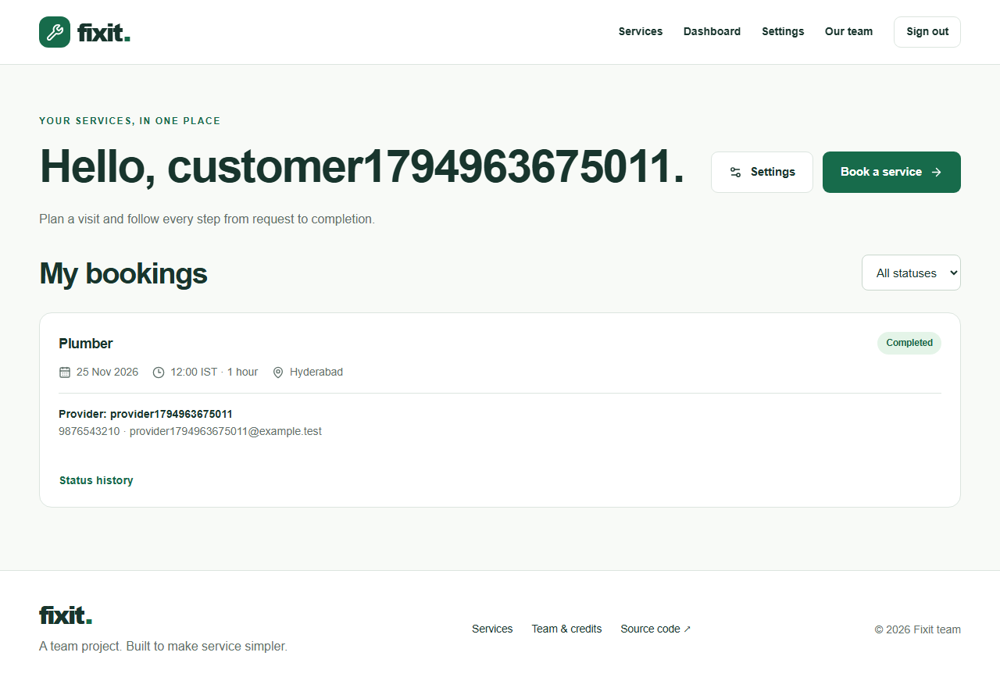
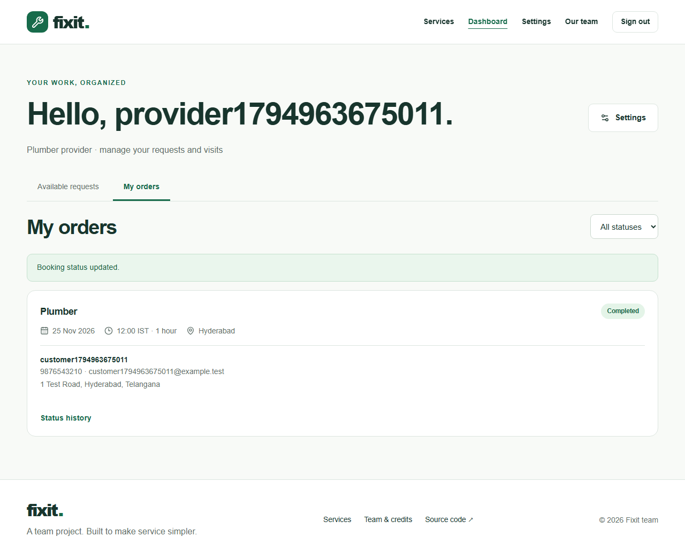

# FIXIT — service booking and management

FIXIT is a team-built service platform. Customers find a service and request an
available visit; providers manage their hours, accept requests and record progress.
This portfolio extension improves security, booking consistency and usability.

The new read-only generative assistant uses GroqCloud's Free plan through a private
server API. The UI, conversation context, catalog/availability tools and authorized
booking summaries are implemented and mock-tested. **Live model verification is
pending; no live AI calls were made during implementation.** See
[chatbot setup](docs/CHATBOT_SETUP.md), [architecture](docs/CHATBOT_ARCHITECTURE.md)
and [test report](docs/CHATBOT_TEST_REPORT.md). It requires a private `GROQ_API_KEY`,
not an OpenAI key, and fails closed without confirmed Free-plan configuration.

**Local verification is recorded in [PHASE_REPORT.md](PHASE_REPORT.md). Public
deployment and relicensing await the team's agreement. No live demo is claimed.**

Latest release review: [FINAL_RELEASE_READINESS.md](docs/FINAL_RELEASE_READINESS.md).
The 2026-11-18 full dependency audit has an unresolved development-tool advisory;
the earlier zero-advisory result is historical. Production release remains blocked.

## Team and provenance

Nikhil is an original contributor to this group project. This repository is a
[fork of the team's repository](https://github.com/vishalkarnati/Fixit). Original
history, photos, links and credits for Nikhil (frontend), Vishal (backend) and
Santosh (UI/UX) are preserved. [CONTRIBUTIONS.md](CONTRIBUTIONS.md) distinguishes
the AI-assisted improvements from the original implementation. Neither repository
declared a license at audit time; no license has been invented.

## Implemented features

- Searchable service catalog, category filters and individual service pages.
- Customer/provider registration, credentials login, logout and protected pages.
- Signed account-ID authorization, runtime validation, safe errors, bcrypt hashing,
  persistent throttles and bounded JSON bodies.
- Weekly provider hours and available one-hour appointments in Asia/Kolkata.
- Idempotent requests, transactional acceptance and database-enforced active slots.
- Provider-specific decline, cancellation, explicit completion and status history.
- Customer history, provider queue/orders, status filters and cursor pagination.
- Profile/contact editing and provider schedule settings.
- Responsive screens, keyboard focus, loading/error/empty states and accessibility checks.

A request stays **pending until a provider accepts**. Acceptance checks availability
again because another request may win the slot. Providers are self-registered;
this demo does not claim vetting or process payments.

## Architecture and stack



Next.js 15, React 19, JavaScript with a strict TypeScript domain module, Tailwind,
Auth.js v5 beta, Zod, MongoDB/Mongoose and bcryptjs. Vitest, Playwright and axe-core
verify the implementation. Yarn Classic is the locked package manager.

Services remain a static catalog. Users, bookings, assignment reservations and rate
limits live in MongoDB. Private operations reload the signed account ID and derive
its role from stored data. Queue responses hide contact information until assignment.
Transactions keep request state and reservation records consistent. See
[architecture](ARCHITECTURE.md), [database design](DATABASE_DESIGN.md) and [API](API.md).

## Local setup — Windows PowerShell

Use Node 24 and the repository root:

```powershell
corepack enable
corepack prepare yarn@1.22.22 --activate
yarn install --frozen-lockfile
# On a fresh checkout only; do not overwrite your configured private file.
Copy-Item .env.example .env.local
notepad .env.local
yarn dev
```

Configure a development MongoDB **replica set**; standalone MongoDB does not support
the required transactions. The localhost example is a placeholder.

| Variable        | Purpose                                             |
| --------------- | --------------------------------------------------- |
| MONGODB_URI     | Private development replica-set/Atlas URI           |
| AUTH_SECRET     | Fresh random signing secret, at least 32 characters |
| AUTH_URL        | Exact origin, e.g. http://localhost:3000 locally    |
| AUTH_TRUST_HOST | Enable only for a trusted proxy that sanitizes Host |

[DEPLOYMENT.md](DEPLOYMENT.md) includes private secret generation, replica-set
requirements, hosting dashboard settings and post-deployment verification.

## Quality checks

```powershell
yarn format:check
yarn lint
yarn typecheck
yarn test
yarn build
yarn playwright install chromium firefox webkit
yarn test:e2e
yarn test:restart
yarn test:migration
yarn audit
```

Tests create disposable replica sets and synthetic accounts, never production data.
Browser tests use real login and the production build. Restart verification uses
the same test database across two application processes. [TESTING.md](TESTING.md)
records evidence and limits. GitHub Actions is configured; a hosted run awaits push approval.

## Screenshots

Actual local application with synthetic test accounts:








## Documentation

- [Audit](DEVELOPMENT_AUDIT.md) and [phase report / quality gates](PHASE_REPORT.md)
- [Architecture](ARCHITECTURE.md), [database/migration](DATABASE_DESIGN.md), [API](API.md)
- [Security](SECURITY.md), [testing](TESTING.md), [performance](PERFORMANCE.md)
- [Deployment](DEPLOYMENT.md), [changelog](CHANGELOG.md), [contributions](CONTRIBUTIONS.md)
- [Interview and resume preparation](INTERVIEW_PREPARATION.md)
- [Technical case study](docs/TECHNICAL_CASE_STUDY.md) and [release readiness](docs/FINAL_RELEASE_READINESS.md)

## Known limits and roadmap

- Existing live records need a reviewed identity/status/index migration. They remain
  intact but are not exposed by unsafe email matching.
- Fixed one-hour visits, hourly starts, Asia/Kolkata only. Travel buffers, variable
  durations and geographic matching need additional domain work.
- Pending requests do not reserve capacity. Schedule changes affect new acceptance;
  existing visits remain assigned. Providers can explicitly start early.
- Email verification, password recovery, OAuth linking, vetting, payments, reviews
  and an admin domain are not implemented.
- Auth.js v5 is beta. The whole JavaScript app is not strict-typed; domain policy is.
- Chromium/mobile-viewport and automated accessibility checks do not replace
  cross-browser or assistive-technology testing. No load-test/Lighthouse score is claimed.
- Rotation was user-confirmed. Remote env-file removal, historical password-log
  response and approved history cleanup remain operational follow-through.
- Publication, relicensing and production migration remain subject to team agreement
  and approval. No production database was changed.
