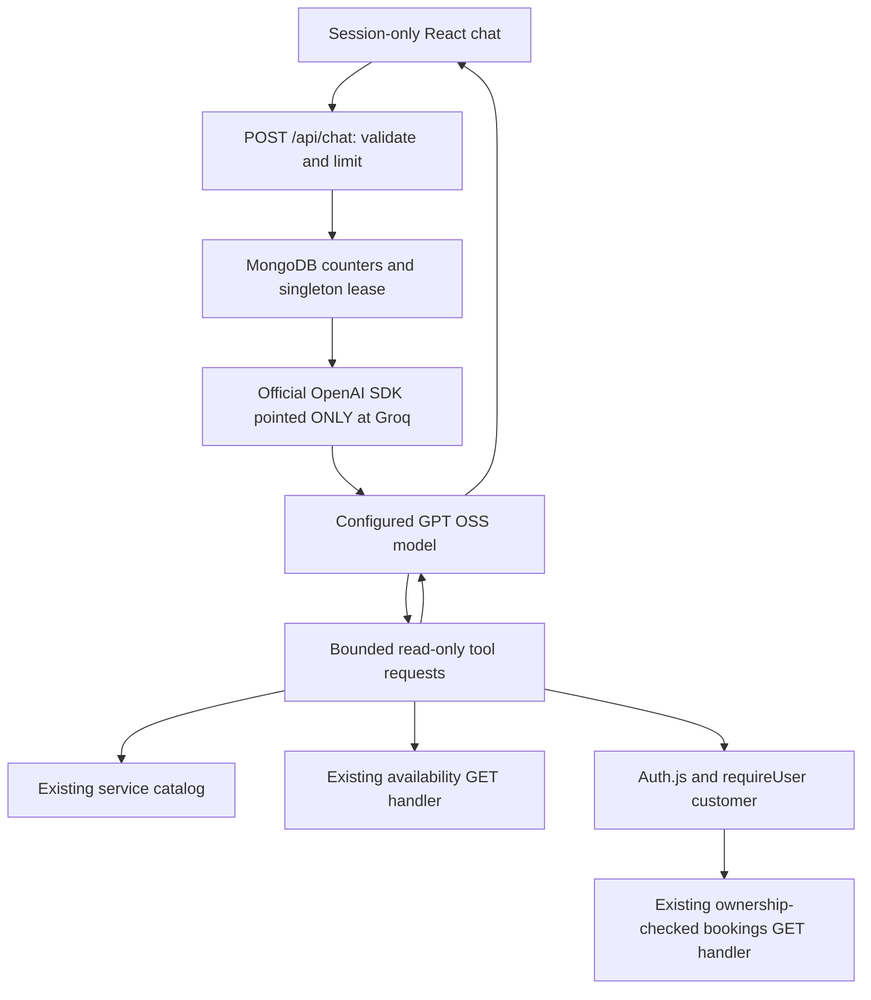

# Chatbot architecture — Groq Free-plan implementation

Status: implemented and tested with mocks; live Groq inference and the account's
Free-plan eligibility are **not verified**. No live API calls were made in this phase.
This feature extends the original group application on `feature/fixit-ai-chatbot`;
it preserves authentication, booking transactions, ownership rules and team credits.

## Request path

Free text is passed to the configured model; there is no keyword/FAQ answer router.
The model decides whether to request a service link, live availability, or own
booking summaries. One tool round (at most three validated calls) and a final
response are permitted, at most two inference calls per chat turn. Built-in search,
code execution, arbitrary HTTP requests and booking mutations are absent.
Unconfigured mode shows ordinary navigation links, not fake AI answers.

`src/lib/chat/knowledge.js` takes exact names/descriptions from the existing catalog
and documents the implemented workflow. Legacy marketing `about` text is excluded
because it contains unverified certification/guarantee claims. Update this policy
summary alongside changes to `booking-policy.ts` and booking routes. No vector
service or duplicate catalog is needed at the current catalog size.

`tools.js` invokes existing GET handlers in-process, preserving server session
verification. `my_bookings` additionally requires a current customer account and
explicit UI sharing permission. It accepts **no identity/query arguments** and
projects only service, date, time and status before anything reaches the provider.
It returns the latest 20 by creation, not an exhaustive upcoming-bookings search.
Availability is aggregated, timestamped, and never a reservation. Verified tool
evidence renders in separate cards beside generated explanations.

## Provider and budget boundaries

The maintained `openai@7.59.0` SDK is a transport client for Groq's documented
OpenAI-compatible endpoint. It never reads an OpenAI key. `server-only` prevents
accidental client imports. Only `https://api.groq.com/openai/v1` and
`AI_PROVIDER=groq` are accepted. Reviewed model IDs are `openai/gpt-oss-20b`
(preferred) and `openai/gpt-oss-120b`; changing models requires explicit
configuration and account verification, never fallback. Unknown configuration or
missing Free-plan attestation fails closed.

| Safeguard          | Enforced bound                                                                  |
| ------------------ | ------------------------------------------------------------------------------- |
| JSON body          | 16 KiB streamed cap, existing origin/content-type checks                        |
| User message       | 1–1,500 trimmed characters                                                      |
| History            | 9 alternating user/assistant messages including latest user                     |
| Combined history   | 10,000 characters; UI retains 4 completed turns                                 |
| Model input        | 5,000 estimated tokens per inference including knowledge/tools                  |
| Model output       | 600 tokens per inference, reasoning effort low; text capped at 4,000 characters |
| Application turns  | 6/minute and 60/day globally                                                    |
| Signed identity    | 3/minute                                                                        |
| Anonymous users    | Shared pool of 3/minute; no forwarding-header identity                          |
| Model calls        | 10/minute and 100/day globally                                                  |
| Token reservations | 7,500/minute and 150,000/day globally                                           |
| Concurrency        | One global MongoDB lease, 45-second expiry, owner-checked release               |
| Timeout            | SDK 20 seconds; generation signal 30 seconds; route maxDuration 40              |
| Retries            | Zero SDK retries, no automatic UI retry or model/provider fallback              |

Token estimates use `gpt-tokenizer@4.1.2`'s `o200k_harmony` encoding on serialized
messages/tools plus 512 framing tokens. The full output allowance is reserved
before each request and not refunded on failure. This is conservative budgeting,
not Groq's exact accounting. Fixed windows can burst at boundaries; Groq quotas
remain authoritative. The second inference must also fit the remaining budget,
so a lookup can end with a quota error instead of a generated answer.

Existing MongoDB rate counters accept an optional weighted cost, defaulting to one
for existing endpoints. `chatcontrols` contains a single `groq` document with
lease/cooldown/token metadata and the built-in unique `_id` index. No secondary
indexes or production migration are required. Expiry is checked in queries, not
dependent on TTL cleanup. Database errors fail closed. Separate databases have
separate caps; share quota storage or isolate Groq organizations across deployments.

Groq retry-after and remaining/reset headers are consumed server-side. A 429 opens
a shared cooldown. Known insufficient token headroom blocks the next request.
The UI does not claim remaining quota. Header observations can become stale if
another application uses the same organization.

The restart regression exposed a cold Mongoose model initialization race. Database
connection buffering now waits at most five seconds, with server selection still
capped at five seconds. This lets models loaded during connection create their
collections/indexes safely; booking transactions and ownership rules are unchanged.

## Privacy and accessibility

Messages stay in React memory: refresh resets them; navigation in the same session
can preserve them; closing/reopening preserves them. Clear conversation and changing
booking-sharing permission discard local history and abort pending requests.
The server shell remounts chat when auth identity changes on navigation/refresh.
No localStorage, persistent transcripts or message logging are used.

Opt-in booking summaries still go to an external provider. User text can contain
personal information; the UI warns against sharing it. A limited detector blocks
common credential pastes, but is not a general PII filter. Review Groq's current
[data policy](https://console.groq.com/docs/your-data) and organization controls;
the application cannot promise provider-side zero retention. Groq's unsupported
`store` parameter is deliberately omitted.

React renders plain text, never HTML/Markdown. Only server-created catalog links
become clickable. Native dialog focus containment, Escape, launcher focus restoration,
labels, live status, errors and scrollable text support keyboard/mobile use.
Automated axe checks do not replace human screen-reader verification.

Prompt injection is constrained by strict schemas and server authorization, not by
trusting a system prompt. Models can still produce inaccurate prose; verified cards
and Dashboard controls remain authoritative. Live semantic, safety, follow-up and
Groq tool-call compatibility evaluation is pending.

Sources reviewed 2026-11-18: [Groq compatibility](https://console.groq.com/docs/openai),
[parameters](https://console.groq.com/docs/api-reference),
[model](https://console.groq.com/docs/model/openai/gpt-oss-20b),
[quotas](https://console.groq.com/docs/rate-limits),
[tokenizer](https://github.com/niieani/gpt-tokenizer).
